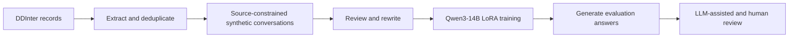

# Patient-Aware Drug Interaction Assessment

**DDInter-grounded synthetic instruction data and LoRA fine-tuning of Qwen3-14B for patient-contextualized drug interaction research.**

This project explores whether adapting an open-weight language model can improve how it explains known drug interactions in the context of a patient profile. It includes interaction extraction, source deduplication, synthetic conversation generation, prompt rewriting, model evaluation, and browser-based human review tools.

Developed by **Kemal Yağız Daşkıran**, Istanbul Technical University. Read the [project report](docs/project_report.pdf) for the research design and findings.

## Reported results

The saved training snapshot contains **829 synthetic conversations**: 529 source-supported interaction cases, 200 source-negative controls, and 100 multi-interaction cases. The retained source snapshot contains **530 DDInter records**. LoRA updated **128,450,560 parameters**, approximately **0.86%** of the model.

| Model | Passing scenarios | Pass rate |
| --- | ---: | ---: |
| Qwen3-14B baseline | 9 / 15 | 60.0% |
| Qwen3-14B + LoRA | 13 / 15 | 86.7% |

The reported difference is **+26.7 percentage points** under the project's case-level rubric. These are the initial evaluation results; this repository cleanup did not rerun training. The revised paper adds paired response measurements (34.1% shorter answers on average), a post-hoc error audit, and measures overlap in the saved artifacts: all 17 annotated test pairs also occur in training. The evaluation contains 15 scenarios, and a post-hoc audit identifies a factual error in an illustrative output. This is a research proof of concept, with no clinical validation. See [evaluation notes](docs/evaluation.md).

The [response analysis](docs/response_presentation_metrics.json) records the word counts, and the [artifact audit](docs/paper_artifact_audit.json) records the case mapping and pair overlap. Raw response transcripts and generated outputs stay local.

## Workflow



The target answer contains four sections: priority interactions, mechanistic explanation, patient-specific risk assessment, and recommendations. Source grounding happens during data generation; runtime retrieval and automatic clinical fact verification are not implemented.

## Quick start

Use Python **3.10 or newer**. The extraction and review tools run on CPU; the training notebook needs a compatible NVIDIA CUDA GPU environment.

```bash
python3 -m venv .venv
source .venv/bin/activate
python -m pip install -e ".[dev]"
```

On Windows, activate with `.venv\Scripts\activate`.

Try the **offline demo**, which needs no API key, database access, or GPU:

```bash
python scripts/demo.py
```

The demo creates an ignored `outputs/demo/` folder. Open `outputs/demo/synthetic_review.html`, `source_review.html`, and `model_review.html` in your browser. They support searching, filtering, inspecting records, and exporting human review notes. The demo uses three hand-authored fictional cases; it demonstrates the software and does not run a model or reproduce the research results.

## Run the research pipeline

From the repository root, configure the key only if using the Gemini-backed stages:

```bash
cp .env.example .env
# Set GEMINI_API_KEY in .env using your editor.
```

Generation, rewriting, and LLM evaluation send the supplied records to Gemini and incur provider usage. Use synthetic inputs for this workflow. Original datasets and model weights are kept out of the public repository; see [data provenance](docs/data.md).

| Command | Purpose | API key |
| --- | --- | --- |
| `ddi-crawl` | Extract DDInter records with request pacing and robots checks | No |
| `ddi-merge` | Deduplicate JSONL files by URL, keeping the first record | No |
| `ddi-negatives` | Sample pairs absent from the project source subset | No |
| `ddi-generate` | Generate, review, and rewrite synthetic conversations | Yes |
| `ddi-sample` | Sample a reproducible label-stratified evaluation subset | No |
| `ddi-rewrite` | Rewrite user prompts while preserving source semantics | Yes |
| `ddi-evaluate` | Add LLM verdicts and build a review page | Yes, except `--html-only` |
| `ddi-review` | Build a synthetic-conversation review page | No |
| `ddi-review-sources` | Build a source-provenance review page | No |

Every command provides `--help`. For example, after obtaining source records:

```bash
ddi-merge data/raw/batch_1.jsonl data/raw/batch_2.jsonl -o data/raw/combined.jsonl
ddi-review-sources --sources data/raw/batch_1.jsonl data/raw/batch_2.jsonl --combined data/raw/combined.jsonl
ddi-generate --input data/raw/combined.jsonl
ddi-review
ddi-sample --seed 42
ddi-rewrite --input data/processed/evaluation_sample.jsonl
```

The default sample has **30 examples**: 20 actionable, 5 source-negative, and 5 multi-interaction cases. Adjust `--actionable`, `--negative`, and `--multi` to match your dataset. The source generator processes one pair per record; these scripts do not automatically construct multi-interaction source cases.

Use [the training notebook](notebooks/finetune_qwen3_14b.ipynb) in a CUDA environment with your own training data and a separately prepared evaluation set. Its detailed setup and export instructions are in [reproduction notes](docs/reproduction.md). Rewriting a training example does **not** make it an independent held-out case.

## Repository layout

```text
src/patient_aware_ddi/     Installable pipeline and review tools
notebooks/               Cleaned Qwen3-14B training/inference notebook
examples/                Small fictional, public demo fixtures
scripts/                 Offline demo and publication checks
tests/                   Offline regression tests
docs/                    Report, provenance, evaluation, and setup notes
data/raw/                Local source records (ignored)
data/processed/          Local generated datasets (ignored)
.github/workflows/       Automated checks on pushes and pull requests
```

Existing local experiments were preserved in `local_archive/`, which is ignored by Git and is not needed by a fresh clone.

## Development and publication

```bash
python -m pytest
ruff check src tests scripts
python scripts/check_publication.py
python -m build
```

GitHub Actions runs tests on Python 3.10 and 3.13, validates the notebook, scans the publication file set, and builds the package. Training, crawling, and paid API calls are outside CI.

See [the GitHub publishing guide](docs/publishing.md) for the first push and suggested repository description. An open-source license has not been selected; the notebook builds on third-party tooling, and DDInter data and model weights have their own terms. See [attribution](docs/attribution.md).
